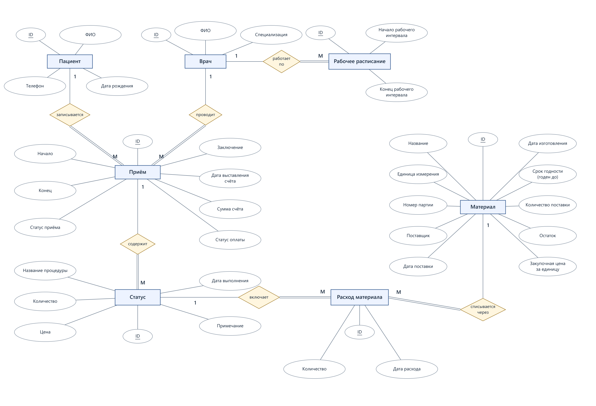

# Этап 2. Концептуальное проектирование

## 1. ER-диаграмма (нотация Чена)

### Сущности и атрибуты

| Сущность | Тип | Атрибуты (ключи подчёркнуты) |
| --- | --- | --- |
| Пациент | Сильная | <u>ID</u>, ФИО, Телефон, Дата рождения |
| Врач | Сильная | <u>ID</u>, ФИО, Специализация |
| Рабочее расписание | Сильная | <u>ID</u>, Начало рабочего интервала, Конец рабочего интервала |
| Приём | Сильная | <u>ID</u>, Начало, Конец, Статус приёма, Заключение, Дата выставления счёта, Сумма счёта, Статус оплаты |
| Статус | Сильная | <u>ID</u>, Название процедуры, Количество, Цена, Дата выполнения, Примечание |
| Материал | Сильная | <u>ID</u>, Название, Единица измерения, Номер партии, Поставщик, Дата поставки, Дата изготовления, Срок годности (годен до), Количество поставки, Остаток, Закупочная цена за единицу |
| Расход материала | Сильная | <u>ID</u>, Количество, Дата расхода |

### Легенда обозначений

- Прямоугольник — сущность, овал — атрибут, подчёркивание — ключ.
- Ромб — связь; 1 и M — кардинальность.
- Двойная линия — обязательное участие, одинарная — необязательное.

### Примечания к диаграмме

Ссылки «Пациент», «Врач», «Приём», «Статус» и «Материал» из этапа 1 показаны связями, поэтому не повторяются овалами. «Статус» — запись о процедуре конкретного приёма; «Материал» — партия поставки.

«Расход материала» связывает процедуру с партией и хранит количество и дату использования. При сохранении расхода уменьшается остаток партии. Через «Статус» расход связан с приёмом, пациентом и врачом; все сущности входят в общую схему.

## 2. Описание связей

| Связь | Сущности | Тип | Смысл | Обоснование типа |
| --- | --- | --- | --- | --- |
| Записывается | Пациент — Приём | 1:M | Пациент имеет много приёмов; у приёма один пациент | Пациент может обращаться повторно |
| Проводит | Врач — Приём | 1:M | Врач проводит много приёмов; у приёма один врач | Каждый приём закреплён за одним врачом |
| Работает по | Врач — Рабочее расписание | 1:M | У врача много рабочих интервалов; интервал относится к одному врачу | Рабочие часы задаются отдельными интервалами для одного врача |
| Содержит | Приём — Статус | 1:M | В приёме несколько процедур; запись «Статуса» относится к одному приёму | Одна запись описывает одну процедуру приёма |
| Включает | Статус — Расход материала | 1:M | У процедуры несколько записей расхода; каждая относится к одной процедуре | Процедура может использовать разные партии материалов |
| Списывается через | Материал — Расход материала | 1:M | У партии несколько расходов; каждый расход списывает одну партию | Одна партия используется в разных процедурах |

На стороне «один» допускается 0..M связанных записей. Каждый приём обязательно связан с одним пациентом и врачом, каждый рабочий интервал — с одним врачом, каждый «Статус» — с одним приёмом. Каждый расход обязательно связан с одной процедурой и одной партией; у процедуры или партии может ещё не быть расходов. Запрет пересечения приёмов и рабочих интервалов проверяется отдельно и не меняет типы связей.

## 3. Слабые сущности

Слабых сущностей нет: у каждой есть собственный уникальный ID. «Статус» и «Расход материала» зависят от других сущностей по смыслу, но их ключи не включают ключи родителей, поэтому они не являются слабыми сущностями.

## 4. Атрибуты связей

У связей нет собственных атрибутов. Время, заключение и данные счёта относятся к «Приёму», сведения о процедуре — к «Статусу». Процедура выполнена, если заполнена дата выполнения. Количество и дата использования партии относятся к конкретному факту расхода, поэтому хранятся в самостоятельной сущности «Расход материала».

## 5. Замечания о M:N

В модели две связи M:N, раскрытые через самостоятельные сущности.

| Исходная M:N | Чем заменена | Преобразование на этапе 3 |
| --- | --- | --- |
| Пациент — Врач | Пациент — Приём (1:M) и Врач — Приём (1:M) | Две ссылки в таблице «Приём»: на пациента и врача |
| Статус — Материал | Статус — Расход материала (1:M) и Материал — Расход материала (1:M) | Две ссылки в таблице «Расход материала»: на процедуру и партию |

Пациент посещает разных врачей, а врач принимает разных пациентов. Одна процедура использует несколько партий материалов, одна партия расходуется в разных процедурах.

Пары «пациент — врач» и «процедура — партия» могут повторяться: у каждого приёма и расхода свой ID. Дополнительных промежуточных сущностей не требуется.

## 6. Итог по этапу 2

7 сильных сущностей, 6 связей 1:M. Две M:N раскрыты через «Приём» и «Расход материала». Слабых сущностей нет. С этапом 1 совпадают все 44 атрибута: 38 показаны овалами, 6 ссылок — связями.
